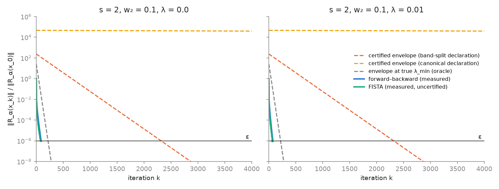
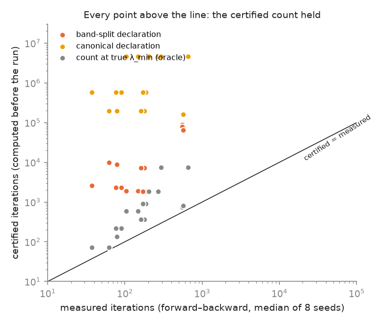

# exp_007 — Deconvolution: certified versus measured iteration count (results)

> Brief frozen 2026-10-10 (`experiment/exp_method.md`, sha256 `893b440a…`).
> Every number below is taken from `results/summary.toml` and `analysis/stats.json`,
> which `analysis/make_analysis.py` derives from `results/runs.jsonl`,
> `results/declarations.jsonl` and `results/arm_b_secant.jsonl`. Calibration:
> `results/calibration.json`, 5 of 5 gates passed. Verdict: **empirical**.

## Headline

On 1-D deconvolution (d = 256), the blur's data term and the first-difference
prior are each degenerate: each has curvature 0 in some direction. Their
kernels meet only at {0}, so the composed energy has a gap that can be
certified from per-term declarations by one Gram eigenproblem. The ℓ1 wavelet
prior adds no curvature at all, as `lem:l1-hessian` says. The AFS plan's
premise fails, and arm B shows it failing.

At the headline configuration (blur width s = 2, prior weight w₂ = 0.1, no ℓ1;
`[headline_s2_w0p1_smooth]`):

| quantity | value |
|---|---|
| true modulus λ_min (exact, from the Fourier multipliers) | 0.1057 |
| certified σ, band-split declaration of D | 0.01162 (= ν₁, the data term's restricted gap) |
| certified σ, canonical declaration of D (ker = constants) | 6.02 × 10⁻⁵ |
| certified iteration count to ε = 10⁻⁶‖R(x₀)‖, band-split | **2 316** |
| certified count, canonical | 570 862 |
| count the same formula gives at the true λ_min (oracle) | 218 |
| measured forward–backward iterations (min / median / max over 8 seeds) | **89 / 90 / 91** |
| measured FISTA iterations (uncertified) | 77 / 77.5 / 78 |
| flops per step / per certificate evaluation | 22 532 / 23 044 |
| certified total cost (band-split) vs measured total | 5.22 × 10⁷ vs 2.03 × 10⁶ flops |
| certificate evaluation / whole solve | 0.0114 (flops); 13.0 µs vs 1.16 ms wall-clock |

The certified count held on every run. Before the run it promised at most
2 316 iterations, and the run took 90. The certified bound is 26× loose. Of
that, a factor 10.6 comes from the declaration (certified 2 316 vs the oracle
218; λ_min/σ = 9.1 plus the log term). A further factor of 2.4 is the
worst-case constant in the count formula itself (oracle 218 vs measured 90).

## Predictions, as frozen

| # | prediction | outcome |
|---|---|---|
| P1 | soundness: measured count ≤ certified count, and distance ≤ ε/σ, on every arm-C run, both declarations | **held**: 812 of 812 checks; worst measured/certified count 0.149; worst distance/bound 0.59 |
| P2a | Δ_w ≤ λ_min in every configuration | **held** (48 of 48) |
| P2b | certified/measured count = (λ_min/Δ_w)·L to within 3× | **FAILED on 16 of 48 cells** (ratio/prediction up to 17.1). The cause is below. |
| P3 | arm B (data + ℓ1): declared σ = 0 for every λ; λ_min(KᵀK) = 0; the secant curvature bound decays like 1/t | **held**: σ = 0 at all 3 values of λ × 3 blur widths; slopes −1.0000 to −0.9997; bound ≤ 2λ‖Wz‖₁/t everywhere (attained) |
| P4 | arm A (data only): energy invariant along the blur's kernel (minimiser not unique); measured count ≤ the restricted-band prediction | **held**: invariance 1.1 × 10⁻¹⁴ relative; measured 455 (s = 2) ≤ 1 623; only the (S2) count is certifiable, ≈ 1.0 × 10¹² |
| P5 | FISTA beats FB on measured count when κ_true ≥ 100 | **held** (2 of 2 such cells). Overall FISTA wins 18 of 24 cells; FB is faster on the other 6 (s = 1 with w₂ = 0.1 and w₂ = 10; s = 2 with w₂ = 1; each with and without ℓ1) |
| P6 | certificate evaluation ≤ 10⁻² of the solve when k ≥ 100; wall-clock within 3× of the flop ratio | **held**: worst 0.0096; wall/flop ratio 0.60–1.03 |
| P7 | canonical count ∝ d² (ratio between d = 1024 and d = 256 in [12, 20]); band-split and measured counts vary ≤ 10% across d | canonical **held** (17.8×: 570 862 → 10 164 514). Measured **held** (9.8%). Band-split **FAILED** (11.7%: 2 316 → 2 586 → 2 586) |
| P8 | argmin over w₂ of the band-split certified count brackets w* = ν₁/ν₂' | **held** at s = 2 and s = 4. **Untestable** at s = 1 (w* = 0.0034 lies below the swept grid) |

### What contradicted the plan, and the two failed predictions

1. **The AFS mechanism is wrong; the arm-B numbers confirm it.** Adding
   λ‖Wx‖₁ at λ ∈ {0.001, 0.01, 0.1} leaves the declared σ at 0 and λ_min(KᵀK)
   at 0, with kernel dimension 169 at s = 2. On a straight line along a
   blur-kernel direction, E grows only linearly: the largest curvature
   consistent with E falls exactly like 2λ‖Wz‖₁/t
   (`analysis/fig3_armB_secant.png`). Arm B still converges in practice
   (median 226 iterations at s = 2, λ = 0.01), but no rate and no distance
   can be certified. Only (S2)'s residual count is available, about 10¹².
   That gap is what H6 should say.
2. **P2b failed, and the reason is in my derivation, not in the theorem.** The
   failures are exactly the cells where the global λ_min is attained in the
   blur's kernel band (s = 2, 4 with small w₂; s = 1, w₂ = 0.01). Because the
   problem is Fourier-diagonal, b = Kᵀy has no component in that band. Starting
   from x₀ = 0, the smooth run therefore never excites the slowest mode, and
   its speed is set by the kept band alone. The certificate must cover every
   start point, so it is correctly more conservative there. Consequence for
   H6: on this instance the smoothness prior's curvature in the kernel band
   buys the **certificate** (uniqueness, the distance bound, the count). It
   does not buy the measured speed. Arm A, with the data term alone, also
   converges (455 iterations at s = 2), but its answer is not unique and its
   count is not certifiable.
3. **P7 (band-split part) failed by 1.7 points.** The cutoff index j_c is
   quantised on the frequency grid, so ν₁ moves with d (0.01162 at d = 256,
   0.01047 at d = 512 and d = 1024). The registered 10% did not allow for
   this. The qualitative claim stands: the band-split certified count stays
   flat with d, while the canonical count grows 17.8× for a 4× increase in d.
4. **Which declaration you choose decides the certified count.** Both
   declarations of the first difference are valid (CAL-3: each passes, and an
   inflated ν fails). The canonical one ("kernel = constants, ν = 4 sin²(π/d)")
   gives counts 1.8× (w = 10) to about 2450× (w = 0.01) worse than the band-split one (above 200× whenever w ≤ 0.1; 246.5× at the headline cell; stats.json table1; corrected 2026-10-10). The band-split
   one uses the data term's cutoff j_c. That is information about a
   neighbouring term, which `rem:declaration-choice` leaves open, and it is
   stated as such.
5. **The weight dial.** The band-split σ saturates at ν₁ once w₂ ≥ w*, while
   β̂ = 1 + 4w₂ keeps growing. The certified count is therefore minimised near
   w* (at w₂ = 0.01 for s = 2 and w₂ = 0.1 for s = 4). The measured count is
   minimised at w₂ = 1 for s = 2 and s = 4 (and at w₂ = 0.1 for s = 1), so the
   certified and measured optima do not coincide.

*Residual traces at s = 2, w₂ = 0.1 (seed 0). The measured FB and FISTA
traces reach ε near k ≈ 75–90. The band-split certified envelope reaches it at
2 316, and the canonical envelope is almost flat.*

*Certified counts (computed before the run) against measured counts for all 24
arm-C cells. Every point lies above the diagonal.*

## Variant G (untruncated Gaussian)

The untruncated Gaussian has no exact null space, but λ_min(KᵀK) = 7.2 × 10⁻¹⁸.
Arm A with this blur hit the 300 000-iteration cap on 8 of 8 seeds. With the
prior added, the data term was declared with K₁ = the high band and
ν₁ = min over the kept band. That declaration is valid but not invariant
(`lem:decl-order`(b)). It certified 2 316 iterations; the runs measured 89–91
(`stats.json` → `variant_G`). The declaration rule handles the "no exact null
space" case by declaring a larger kernel than the true one.

## Scope

The evidence covers one signal, 1-D only, circulant operators, d ≤ 1024 and
fixed weights. FISTA is measured only: `thm:soundness` certifies only the
constructed FB iteration. No image-quality claim is made. 2-D was not run.
The registered numbering clash with the INDEX's "exp_007 (E6)" is noted in
`v3/INDEX.md`.
