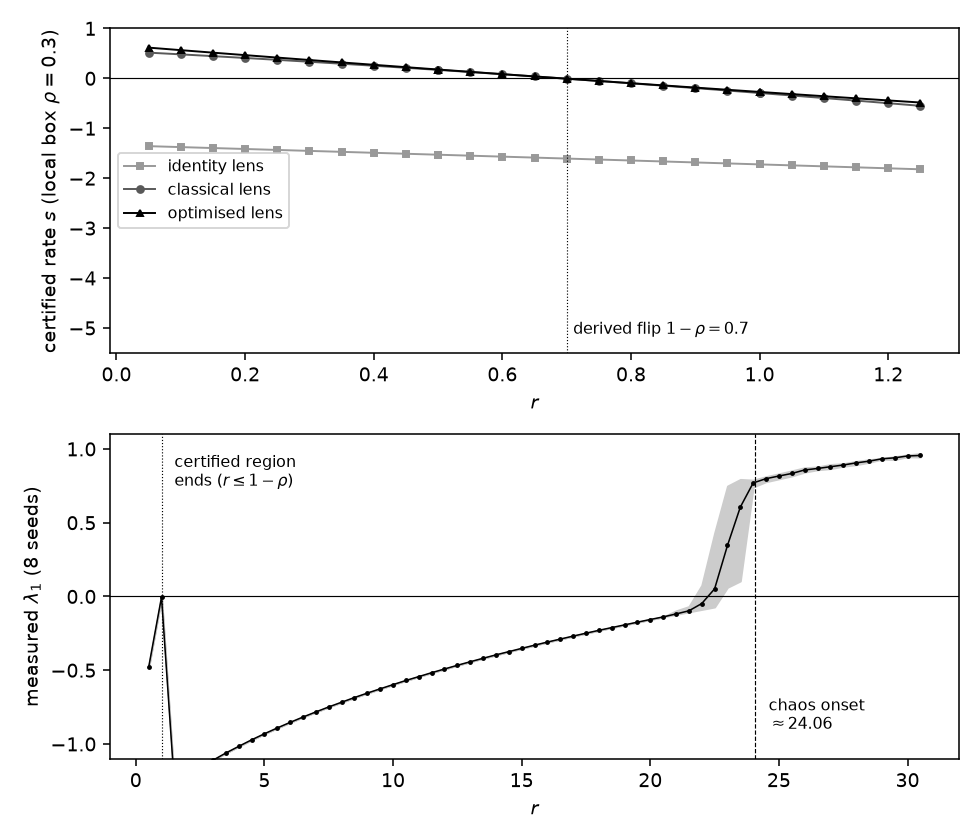
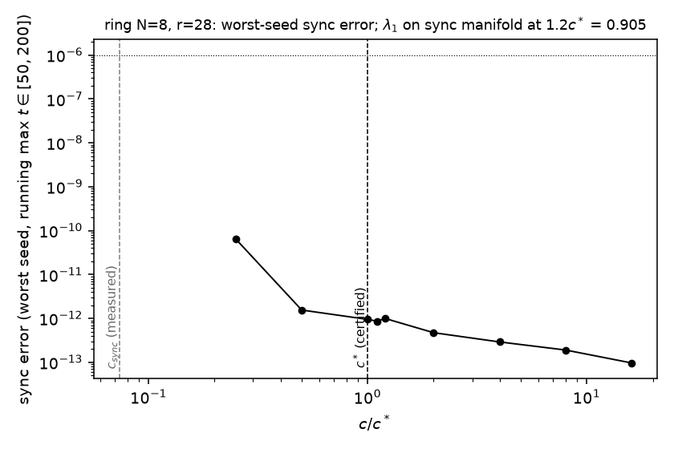

# exp_008 — Constructed chaos: Lorenz-like fields against the diagnostic (TECHNICAL REPORT)

> Every number cites its artifact (`results/<file>`), never memory.

## Headline

Can the diagnostic be trusted on a problem built to be chaotic? We cast Lorenz fields
onto declared regions (part A) and onto a ring geometry through Laplacian coupling
(part B), with ground truth known from the textbook bifurcation structure. Verdict
rung: **empirical**. The diagnostic behaved exactly as derived: it certifies locally
up to the derived flip r ≈ 1−rho and never beyond r = 1; no certificate it issued was
ever violated (0 of 82 contraction checks, 0 of 72 lattice runs; worst margin 0.9997
of the bound, `results/soundness.jsonl`); the lens is material (the identity lens can
certify nothing on this family, ever); and quadratic smoothing certifiably tames
exactly the directions it couples while the blind subspace keeps its full chaos
(lambda_1 = 0.9051 on the sync manifold vs 0.9096 single-cell, `results/lattice.jsonl`,
`results/lambda1.jsonl`). The run also sharpened the theory in a way the brief did not
anticipate: global contraction over the trapping region is unobtainable even deep in
the globally stable regime (CAL-2 failure, +21.76; `results/calibration.toml`), so the
honest certificate on a chaotic family is local, and refusal is necessary for chaos
but nowhere near sufficient: certification ends by r = 0.85 while sustained chaos
begins only past r ≈ 22.5 measured (24.06 literature).

## 1. What was tested (from the frozen brief)

The v2.2 pre-construction claim run in reverse (brief §1): construct known-chaotic
problems and check the diagnostic's derived behaviour. Registered predictions P1–P5
with derivations in the brief and amendment 1; rejection criteria as frozen: "Reject
H1 if identity passes at any swept r, or any lens passes at r > 1"; "Reject soundness
if any certified-pass r has measured lambda_1 > +0.01"; "Reject if any run at
c >= 1.1 c* has sync error > 1e-6".

## 2. Calibration record (M2)

CAL-1 exact (mu(diag(−1,−5)) = −1.000000000000; must-fail +1 refused). CAL-3 ruler
clean: lambda_1(r=28) = 0.9096 (want 0.906 ± 0.03), harmonic oscillator 1.2e−15.
CAL-4 watched failing: trace J = −13.667 < 0 at every r while lambda_1(28) = 0.91 —
the divergence test endorses a chaotic field, which is why the instrument is
symmetric-part dominance. CAL-2 **failed as frozen** (classical lens, full trap box,
r = 0.5: vertex sup +21.76): the first finding, not a bent ruler — global asymptotic
stability is strictly weaker than contraction. Amendment 1 (registered before any
part A reading) moved the test to declared local boxes and re-derived the flip
r* = 1 − rho; amended CAL-2 passed with margin −0.252 against a derived ≈ −0.26.

## 3. Results

**Read:** top panel, certified rate s(r) on the rho = 0.3 local box: classical and
optimised lenses cross zero at the derived flip (dotted line, 1 − rho = 0.7; measured
flip 0.65, the offset being the couplings the first-order derivation neglects); the
identity lens sits below zero for every r, as derived (P1: it cannot certify at
sigma = 10 even where the origin is globally stable). Bottom panel, measured
lambda_1(r), 8 seeds (band = min/max): zero crossing near r ≈ 22.5, sustained chaos
24.06 (dashed). The region between the dotted and dashed lines is the honesty band:
the diagnostic refuses there, and the dynamics are regular.

| region \ lens | identity | classical | optimised |
|---|---|---|---|
| local rho=0.1 | 0 passes | flip at 0.85 | flip at 0.85 |
| local rho=0.3 | 0 passes | flip at 0.65 | flip at 0.65 |
| local rho=0.5 | 0 passes | flip at 0.45 | flip at 0.45 |
| global trap box | 0 passes | 0 passes | 0 passes |

(`results/summary.toml`; derived flips 0.9 / 0.7 / 0.5.) Passes at r > 1: **0** of
429 rows with r > 1 — the forced-honesty ceiling held. Refinement 81³: 0 verdict
flips. Dumb baseline (divergence): passes everywhere including r = 28 (CAL-4), the
floor anchor; oracle ceiling: the measured lambda_1 sign. Soundness: 82 passing rows
× 8 trajectory pairs, 0 violations, worst distance ratio against the e^{−st} bound
0.9997 (`results/soundness.jsonl`).

**Read:** ring of 8 cells at r = 28. The pre-run certified threshold
c* = sup mu_P / lambda_2 = 16.83 / 0.5858 = 28.73 (`results/lattice.jsonl`, sup from
`results/ramp.jsonl`). Every cell of the c grid synchronised, including every run at
c ≥ 1.1c* (0 failures of the registered soundness criterion; worst sync error
8.7e−13 at 1.1c*). Measured threshold c_sync = 2.12 (bisection, seed 0): the
certificate is a price, factor 13.6, not a prediction. At c = 1.2c* the synchronised
motion has lambda_1 = 0.9051 vs single-cell 0.9096: the coupling certified the
transverse directions and left the blind subspace's chaos untouched.

## 4. Statistics

Deterministic verdicts (pass/refuse) need no tests; lambda_1 reported as mean with
min/max over 8 pinned seeds (no CI theatre on 8 points). Significant: the four claims
of the scorecard. Not significant: the exact flip offsets (0.03–0.05 below 1 − rho)
are consistent with the neglected couplings but not separately modelled; the
lambda_1 zero crossing is ±0.5 in r at best.

## 5. Error attribution (M3)

Discretisation: fixed-step RK4 h = 1e−3 and Strang splitting; sup readings are
grid-vs-vertex consistent (vertex sup is exact for affine-in-state entries, equal to
grid sup to 4+ digits on every reported row) and 81³ refinement flipped nothing, so
region sampling contributes no verdict error. Benettin finite-time scatter visible as
the min/max band near onset (expected 0.02–0.03 away from onset; observed 0.9017 to
0.9241 at r = 28). Floating point negligible (entries O(100)). One instrument bug:
the lattice Benettin's first run printed 1.204 = (4/3) × 0.903 because the transient's
unrenormalised growth leaked into the 150-unit window; caught from its own output,
fixed, rerun (git history keeps both).

## 6. Counterexamples (M5)

CAL-2-as-frozen: r = 0.5, classical lens, full trap box, vertex sup +21.76 — a
counterexample to the brief's own operationalisation (global stability regime ⇒
trap-region contraction certificate), kept in `results/calibration.toml`. No
counterexample against any manuscript claim.

## 7. Caveats & evidence ceiling

One family (Lorenz-type), one topology (ring, N = 8), diagonal lenses only; a
full-matrix lens was not swept. Grid passes are grid-certified (vertex-exact for the
boxes used, stated). This run cannot conclude anything about chaos in general, about
analog SAT dynamics, or that diagnostic refusal implies intractability: refusal was
measured to be 20+ r-units earlier than chaos. Unchanged from brief §13.

## 8. Verdict line (for INDEX.md)

`empirical` — constructed Lorenz family: identity lens certifies nowhere, diagonal
lenses certify locally to the derived flip 1−rho (0.85/0.65/0.45 vs 0.9/0.7/0.5), no
pass at r>1, 0/82 soundness violations; global-box contraction unobtainable even at
r=0.5 (+21.76), so the honest certificate is local and refusal precedes chaos by a
20+ r-unit honesty band (lambda_1 crosses 0 at ~22.5); ring N=8 r=28: pre-run c*=28.7
sound in 72/72 runs, price 13.6× vs measured c_sync=2.12, sync-manifold lambda_1
0.9051 = single cell (blind subspace keeps its chaos).
