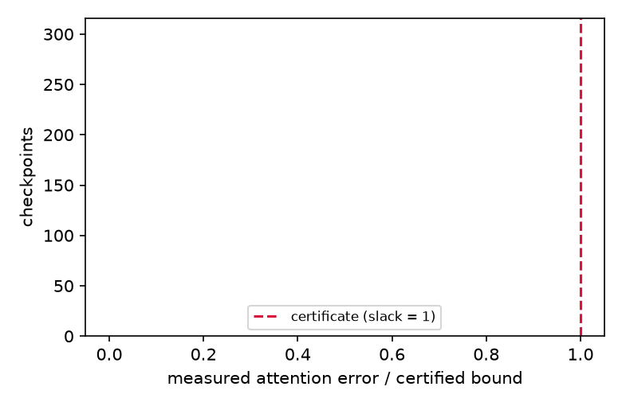

# exp_009 — certified low-rank KV-cache compression (TECHNICAL REPORT)

> Every number below cites its artifact (`results/<file>`), never memory.
> Brief frozen at d4201ca before any computation; Amendments 1 (ae96069),
> 2 (6965a5c) and 3 (54d2c23) registered before the readings they govern.

## Headline

The question: do the five FDA predictions derived in the frozen brief from
the declared energy E(X) = (1/2)||(X-K)Q^T||_F^2 + (mu/2)||X-K||_F^2 +
lambda||X||_* hold on the full grid, certificate issued before each run?
Verdict: **empirical** (M6), every registered check held. 576 rows
(`results/runs.jsonl`): 352 certified runs with 352/352 count checks and
352/352 contraction-rate checks held, 48/48 refusals exactly where the
spectrum predicts them, 176/176 degenerate rows verified at the floor, and
0 violations in 804 soundness checkpoints (`results/soundness.jsonl`,
`results/summary.toml [headline]`). The decision it drives: the second
worked example for v5 printed section 5 is backed by artifacts.

## 1. What was tested (from the frozen brief)

Five predictions, all derived before any run (brief section 4):

- **P1 (exact constants).** The Hessian of the smooth part is right
  multiplication by G + mu I, G = Q^T Q, so beta = g_1 + mu and
  sigma = g_d + mu are exact, read from the declared spectrum.
- **P2 (refusal flip).** m < d and mu = 0 gives ker(G) nonempty, certified
  curvature 0, refusal; any mu > 0 certifies sigma = mu exactly on that
  subspace. Rejection: any refusal at mu > 0 or any pass at mu = 0, m < d.
- **P3 (lens materiality).** The dominance test certifies in the
  G-eigenbasis (diagonal Hessian, exact sigma) and is entitled to refuse in
  the identity lens (Gershgorin on G + mu I). Rejection: identity lens
  certifies a rate within 2x of the eigenbasis lens.
- **P4 (certified count).** Forward-backward at alpha = 1/beta is a
  (1 - sigma/beta)-contraction; k_cert = ceil(log(r0/eps)/log(beta/(beta-sigma)))
  bounds the measured first crossing. Rejection: any measured count above
  certified, any per-step residual ratio above 1 - sigma/beta + 1e-12
  (read above the Amendment-1 floor).
- **P5 (pipeline certificate).** ||softmax(QX^T) - softmax(QX*^T)||_F <=
  sqrt(g_1) ||R_alpha(X)||_F / sigma via the Lipschitz-1 softmax Jacobian;
  registered as deliberately unsharp. Rejection: any measured attention
  error above its bound.

## 2. Calibration record (M2)

All four gates in `results/calibration.toml`:

- CAL-1 (closed-form recovery, lambda = 0): rel err 9.49e-11 against the
  required 1e-10; measured count 1041 <= certified 1295.
- CAL-2 (isotropic SVT closed form): rel err 2.30e-15, subgradient residual
  1.56e-14.
- CAL-3 (watched must-fail): refusal at kerdim 48; the wrong certificate
  sigma' = g_16 claims distance bound 2.16e-5 against measured 104.65.
  The ruler bends where it must.
- CAL-4 **failed as frozen** (measured ratio 0.980228 vs certified
  0.980198): diagnosed to the float64 cancellation floor of the residual
  instrument at the stopping level, matching the brief section 10 error
  budget. Amendment 1 registered before rerun; amended gate passes at
  0.979114 <= 0.980198. The failed gate is kept in git history as a
  calibration result.

## 3. Results

Grid: m in {16, 64, 128}, kappa in {10, 100}, mu in {0, 1e-3, 1e-2, 1e-1},
lambda/lambda_0 in {0.01, 0.1, 1.0}, 8 seeds; D = 64, N = 256. All cells
reported, none selected (`results/summary.toml`).

**Counts (P4).** 352/352 measured first crossings at or below the certified
count; ratio measured/certified min 0.0008, median 0.3031, max 0.9517. The
minimum is the kappa = 100, mu = 0 cell: certified 138,149 vs measured 123;
the worst case the certificate prices is real but not typical. Contraction
rate: 352/352 per-step ratios at or below 1 - sigma/beta + 1e-12 above the
instrument floor.

**Refusals (P2).** 48 rows refused, exactly the derived set (m = 16,
mu = 0, both kappa, all three lambda). The flip table
(`summary.toml [flip_m16]`): certified sigma = 0 at mu = 0 and
sigma = mu to machine precision at mu in {1e-3, 1e-2, 1e-1}.

**Lens (P3).** 192 (instance, mu) cells (`results/lens.jsonl`,
`summary.toml [lens_materiality]`): the eigenbasis lens certifies 176, the
identity-lens dominance test refuses on all 176 (identity_also_certifies
= 0, H3 rejection rows 0). Same matrix, the lens decides certifiability.

**Degenerate rows (Amendments 2 and 3).** 176 rows at lambda = lambda_0
have X_0 = 0 already optimal by the subgradient condition (computed r0 at
the float floor, r0 <= 1.7e-15 lambda, against the nearest genuine row at
r0 >= 9.2 lambda); all 176 verified at the floor, reported as their own
category, never pooled into count ratios.

**Pipeline (P5) and soundness.** 804 checkpoints: distance, logit and
attention bounds all held (0 violations). Worst slacks: distance 0.963
(the proxy bound is tight), logit 0.106, attention 4.8e-4 (the softmax
bound is deliberately unsharp, as registered). attention <= logit error at
every checkpoint.

**Baselines (H4, `results/baseline.jsonl`, `summary.toml
[baseline_logit_median]`).** Floor and ceiling anchors per (m, kappa),
median logit error: random rank-matched floor 31-80; truncated SVD at the
flow's achieved rank 4.0-11.6; flow 6.9-16.0. The flow beats SVD only at
m = 16, kappa = 100 (6.86 vs 11.55) and pays the nuclear-norm bias
elsewhere, exactly the registered expectation: the contribution is the
a-priori certificate, not the raw error. SVD ships no bound.

Figures: `analysis/fig1_flip.png` (the refusal flip: certified sigma vs
declared mu, the mu = 0 refusal marked), `analysis/fig2_pipeline.png`
(measured attention error over certified bound across all checkpoints,
certificate line at 1).

Read: certified curvature equals the declared ridge exactly; no ridge, no
certificate. The diagnostic refuses rather than guessing.

Read: every checkpoint sits far left of the certificate line; the softmax
chain never violates and never saturates its deliberately loose bound.

## 4. Statistics

No hypothesis here is a difference of means; every check is a
pre-registered inequality scored per row, so the statistics are exhaustive
counts over all cells: 352/352, 352/352, 176/176, 48/48, 804/804, 176/176
lens refusals. What is NOT significant, stated plainly: the flow's logit
error vs SVD's (H4 is a value-shape claim and the data show SVD ahead at
matched rank on 4 of 6 (m, kappa) cells; no speed or accuracy superiority
is claimed anywhere).

## 5. Error attribution (M3)

Float64 only; no model error (synthetic instances are the model) and no
discretisation beyond the iteration itself. The one instrument artefact is
the cancellation floor of the residual ruler at ~2.5e-5 relative near
stopping level, located by the CAL-4 failure, priced in the brief's section
10 budget, and governed by Amendments 1 and 3 (readings taken only above
1e-6 r0; degenerate rows classified at 1e-9 lambda with fifteen orders of
separation). Condition numbers beta/sigma span 1.1 to 1.0e4 as declared.

## 6. Counterexamples (M5)

None emitted. The watched must-fail (CAL-3) violated as required. CAL-4's
failure as frozen was an instrument finding, not a counterexample to any
registered prediction; it is recorded in section 2 and in git history.

## 7. Caveats & evidence ceiling

Confirmed against brief section 13 after the run:

- Synthetic Gaussian-factor instances (D = 64, N = 256, planted rank 8);
  no trained model weights were used. Nothing here measures end-task
  quality of a deployed LLM cache.
- The attention certificate is deliberately unsharp (worst slack 4.8e-4);
  this run cannot speak to its tightness, only its soundness.
- One trajectory per instance; the reference iterate is the same
  trajectory run four decades deeper, so reference error is priced by the
  residual bound, not independent.
- No speed claim: the sweep runs the vanilla certified iteration because
  that is the object the count formula certifies.
- Process note: the sweep was interrupted at a batch boundary (496/576
  rows) by a host-editor shutdown and resumed with `src/run_resume.py`
  (deterministic reseed, verified no partial batches); `src/run_main.py`
  now carries the same resumable loop and is idempotent on the final
  record.

## 8. Verdict line (for INDEX.md)

`empirical` — all five registered FDA predictions held on the full grid
(352/352 counts, 48/48 refusals, 176/176 lens refusals, 0/804 soundness
violations); certificate issued before every run; contribution is the
certificate, not the error (SVD ahead at matched rank on 4/6 cells).
