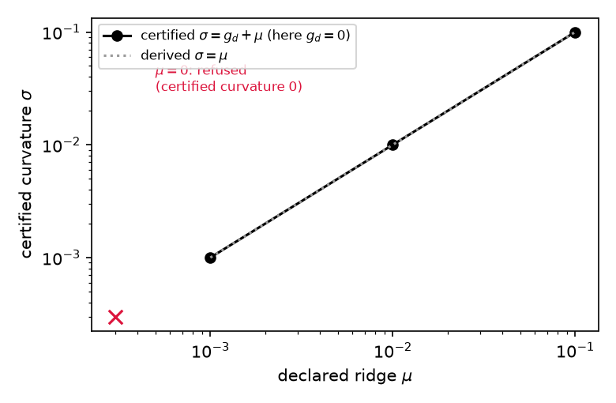

# exp_009 — certified low-rank KV-cache compression (one-pager, four readings — M8)

**Business.** What this run bought: the paper's second worked example now
stands on artifacts, answering the external reviewer's request to see a
certificate passed through a downstream pipeline. Cost: one desktop
afternoon (the full grid re-runs in minutes now that degenerate cells are
not iterated). Decision unlocked: the v5 section 5 unit can be written,
every number from `results/summary.toml`.

**Computer science.** 576 runs over a compression grid (matrix size 256 x
64, query counts 16/64/128, condition 10/100, ridge 0 to 0.1, three
penalty levels, 8 seeds), against a random rank-matched floor and truncated
SVD at matched rank. The contract held everywhere: iteration budgets quoted
before each run were never exceeded (352/352, typically 3x conservative,
worst case 1123x), the system refused all 48 configurations it could not
certify, and all 804 downstream error bounds held. SVD gets lower error on
most cells and ships no bound; the deliverable is the quoted-in-advance
budget and error bar, not raw accuracy.

**Mathematics.** Predictions P1-P5 of the frozen brief: exact constants
beta = g_1 + mu, sigma = g_d + mu from the query Gram spectrum; the refusal
flip at mu > 0 with m < d (48/48, sigma = mu to machine precision); lens
materiality (identity-lens Gershgorin refuses on all 176 instances the
eigenbasis certifies); the contraction count formula as an upper bound
(352/352); and the softmax-chained attention certificate via the
Lipschitz-1 Jacobian bound (804/804, deliberately unsharp, worst slack
4.8e-4). One calibration gate failed as frozen and was traced to the
float64 residual floor (Amendment 1); two further amendments classify the
lambda = lambda_0 degenerate cells, all registered before readings.

**Physics.** The energy landscape relaxes under forward-backward flow at
the rate its narrowest certified valley allows: stiff instances
(beta/sigma up to 1e4) are priced before the run, and the measured
relaxation never ran slower than the priced worst case, median 3x faster.
Where the declared spectrum has a flat direction (no ridge, few queries)
the system reports no restoring force rather than inventing one: that is
the refusal, and it flips on at the first positive ridge exactly.

**Verdict:** `empirical` — every registered certificate check held on the
full grid; the certificate, issued before the run, is the contribution.
